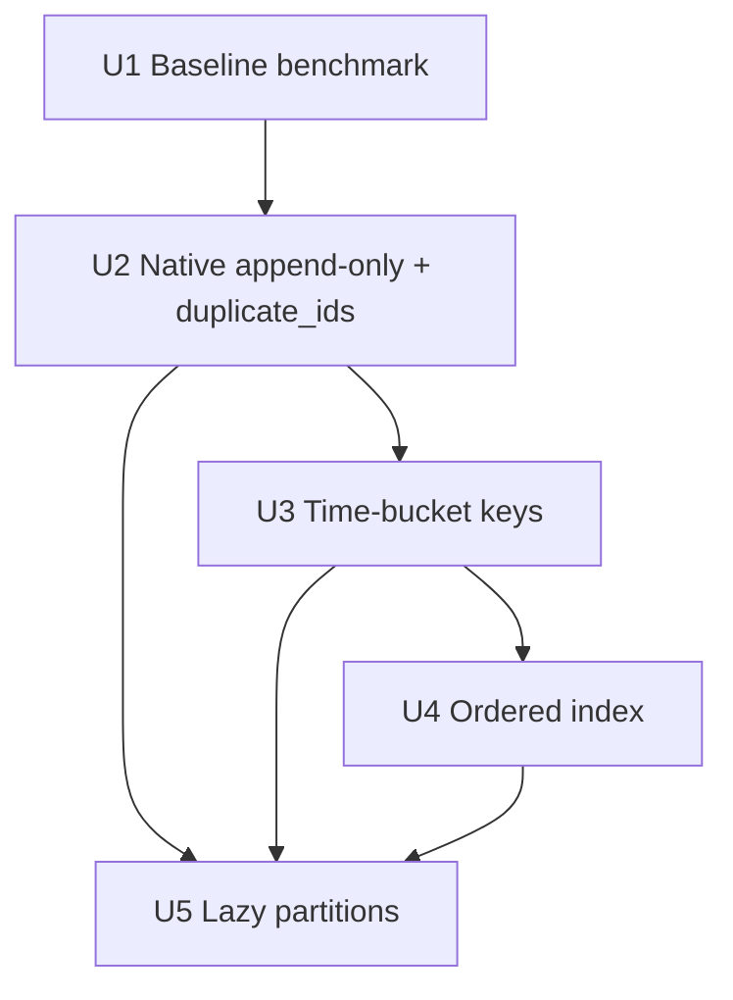

# feat: Native time-series collections

## Summary

Make the native Rust runtime hold years of high-volume samples as partitioned JSONL collections. Opening, appending and querying a time range must stay fast and use little memory as history grows. The work has five measured steps: baseline, native append-only with `duplicate_ids`, time-bucket partition keys, an ordered index, and lazy partitions. The approved contract of 2026-10-20 is binding; the openspec change `openspec/changes/native-timeseries/` holds the design and spec deltas.

---

## Problem Frame

The first consumer is a headless health-data store that links `proseql-native` the same way Coach does. It needs heart rate, steps and similar metrics at about 525,600 rows per metric per year, for 10 years and several metrics. Today (commit `0e3666a`):

- `load_partitioned_source` decodes every partition at open. Memory and open time grow with total history.
- `plan_partitioned_source` encodes the whole changed partition for one insert.
- The engine has no ordered index; range filters scan the collection.
- `PartitionKey` cannot derive a month from an ISO timestamp, so records need a redundant `month` field.
- The engine already refuses update/delete/upsert for `append_only`, and the WASM engine appends JSONL for single-file collections only. Native append, partitioned append and idempotent re-append are missing.

---

## Requirements

- R1. A repeatable benchmark (`just bench-timeseries`) measures open time, peak RSS, insert cost, bytes written per insert and one-hour range-query cost at 140k, 1M and 10M synthetic rows over 10 years, before and after each step.
- R2. In native source mode, `append_only: true` collections on JSONL/NDJSON `CollectionFile` and `Partitioned` sources append complete lines and never encode the file again. Write failures reach the caller as `StorageError`, roll back and quarantine. Memory never goes ahead of disk.
- R3. `duplicate_ids: "ignore_identical"` makes an identical re-create a no-op success and a different payload a `DuplicateKeyError`, in the engine for native and WASM. A batch conflict writes nothing.
- R4. `PartitionKey::TimeBucket { field, bucket: Year | Month | Day }` derives the key from a UTC `Z` timestamp and rejects other values on write and load.
- R5. `ordered_indexes` makes range filters and sorts on the field use an index, with results identical to the unindexed path.
- R6. `lazy_partitions` opens a qualifying source without decoding, loads only partitions a filtered query can touch, bounds loaded partitions with LRU eviction, and reports `partitions_loaded` and `index_used`.
- R7. Coach keeps building and passing at the new commit without any change to Coach. Existing configurations load, save and keep their bytes.
- R8. All data is synthetic. Nothing from `~/.local/share/coach/` enters the repository, logs or history.

---

## Scope Boundaries

- No health-data server, RPC interface or importer.
- No deduplication across sources.
- No change to Coach (`/home/simonwjackson/code/sandbox/coach/server`); it is read-only.
- No field on `DocumentSourceConfig`, `DocumentGraphRootConfig`, `DocumentGraphSourceConfig` or `NativeSourceRuntimeConfig`.

### Deferred to Follow-Up Work

- Cross-partition ID uniqueness under lazy loading (documented limit; IDs should derive from the partition field).
- Lazy partitions and partitioned append for the WASM engine (native only on purpose; see Parity).

---

## Key Technical Decisions

| Decision | Rationale |
|---|---|
| New descriptor fields use `#[serde(default, skip_serializing_if = ...)]` | Coach deserializes `Vec<CollectionDescriptor>` from JSON; old JSON must parse and serialize byte-identically. |
| `lazy_partitions` lives in `NativeSourceRuntimeOptions` | Coach builds options with `..Default::default()`, so a new field with an empty default is compatible; the config structs it builds with literals stay unchanged. |
| `duplicate_ids` is implemented once in the engine | One implementation keeps native and WASM identical. |
| Append lines use the rewrite encoder | A later rewrite gives the same bytes, so append and rewrite paths cannot drift. |
| Lazy pruning compares string intervals | Conservative: it never skips a partition that could match. |
| The benchmark is an example with one child process per size | Peak RSS (`VmHWM`) is per process; durable filesystem writes need real files; no new dependency. |

### Parity

| Feature | Native | WASM (`packages/engine`) | Legacy core (`packages/core` runtime) |
|---|---|---|---|
| `duplicate_ids` | yes | yes (engine) | config rejected (fail closed) |
| Partitioned append without rewrite | yes | no, on purpose (keeps rewrite) | no |
| TimeBucket key | yes | yes (core's `partitioned-source.ts`, shared) | yes |
| Ordered index | yes | yes (engine) | accepted, not used for planning; same results |
| Lazy partitions | yes | no, on purpose | no |

---

## Implementation Units

### U1. Baseline benchmark

**Goal:** Measure today's behaviour before any runtime change.

**Requirements:** R1, R8

**Files:**
- Create: `crates/proseql-native/examples/timeseries_bench.rs`
- Modify: `justfile` (`bench-timeseries`)
- Create: `docs/benchmarks/timeseries.md`

**Approach:** Fixed-seed synthetic heart-rate rows in monthly JSONL partitions under the system temp directory, cached by rows, span and seed. One fresh child process per size on a fresh copy. Open with `NativeRuntime::open_sources_with_host`, a `Partitioned` JSONL source and `PartitionKey::Field { field: "month" }`. A counting storage host measures bytes read and written per operation. `--mode` selects later feature sets.

**Verification:** Release run at 140k, 1M and 10M rows over 10 years, recorded with machine, commit and command. If 10M cannot finish, record the partial numbers and the reason.

### U2. Native append-only and `duplicate_ids`

**Goal:** Append without rewrite; idempotent re-append.

**Requirements:** R2, R3, R7

**Files:** `crates/proseql-engine/src/descriptor.rs`, `collection.rs`; `crates/proseql-storage/src/partitioned.rs`, `persistence.rs`, `collection_file.rs`; `crates/proseql-native/src/lib.rs`, `sources.rs`; `packages/engine/src/…` (config mapping); `packages/core/src/…` (reject `duplicateIds`); `docs/native-sources.md`.

**Test scenarios:** idempotent re-append; conflicting re-append (single and batch); refused update and delete; crash during append (fault injector and subprocess); torn final line (parseable and not); byte-identical rewrite after appends; own appends do not reload; old descriptor JSON round-trips byte-identically.

**Verification:** `--mode append` numbers in "Step 2 append".

### U3. Time-bucket partition keys

**Goal:** Derive monthly (and yearly/daily) partitions from a timestamp.

**Requirements:** R4, R7

**Files:** `crates/proseql-storage/src/source_config.rs`, `partitioned.rs`; `packages/core/src/storage/source-config.ts`, `partitioned-source.ts`; `docs/native-sources.md`.

**Test scenarios:** each bucket; invalid timestamps on write and load; wrong partition on load; native/TS placement parity.

**Verification:** `--mode timebucket` numbers in "Step 3 time bucket".

### U4. Ordered index

**Goal:** Index-backed range filters and sorts.

**Requirements:** R5, R7

**Files:** `crates/proseql-engine/src/descriptor.rs`, `query/indexes.rs`, `query/pipeline.rs`, `collection.rs`; `packages/engine/src/…`; parity corpus.

**Test scenarios:** same results and order with and without the index (mixed types, missing fields, ties, pagination); maintenance on create/update/delete/rollback.

**Verification:** `--mode ordered` numbers in "Step 4 ordered index".

### U5. Lazy partitions

**Goal:** Open and query cost independent of total history.

**Requirements:** R6, R7

**Files:** `crates/proseql-native/src/sources.rs`, `lib.rs`; `crates/proseql-storage/src/partitioned.rs`; `docs/native-sources.md`; consumer note.

**Test scenarios:** filtered and unfiltered query correctness; eviction and pinning; `full_scan: Error`; non-qualifying configuration rejected; watcher hashes loaded partitions only.

**Verification:** `--mode lazy` numbers in "Step 5 lazy" meet the acceptance table below.

---

## Acceptance

Command: `just bench-timeseries` (`--rows 140000,1000000,10000000 --years 10`). At 10M rows versus 140k rows:

| Measure | Target |
|---|---|
| Lazy open time and RSS | ≤ 2× the 140k values |
| Append, median over 1,000 | ≤ 2×; bytes written = line length; earlier file bytes unchanged |
| One-hour range query | `partitions_loaded = 1`, `index_used = ordered`, time ≤ 2× |

---

## Risks & Dependencies

| Risk | Mitigation |
|---|---|
| A new descriptor field changes Coach's serialized JSON | serde default + skip; byte round-trip test with the Coach schema fixture. |
| A torn append is mistaken for corruption, or corruption for a torn append | Only an unterminated final line in an append-only JSONL file is tolerated; all other malformed lines stay errors. |
| Lazy loading breaks engine assumptions (relationships, unique fields, aggregates, watches) | Lazy mode requires no relationships and no unique fields; aggregates and watches load or pin the partitions they touch; documented in `docs/native-sources.md`. |
| The baseline 10M run does not fit in memory on the benchmark machine | The harness enforces `--max-rss-mb` and reports partial numbers; the target is not shrunk. |

---

## Sources & References

- Contract: approved 2026-10-20 (config shapes, re-append, failure rules, lazy partitions, parity, acceptance).
- `openspec/changes/native-timeseries/`
- `docs/native-sources.md`
- `crates/proseql-storage/src/partitioned.rs`, `persistence.rs` (`append_data`)
- `crates/proseql-engine/src/descriptor.rs` (`append_only`), `collection.rs`, `query/indexes.rs`
