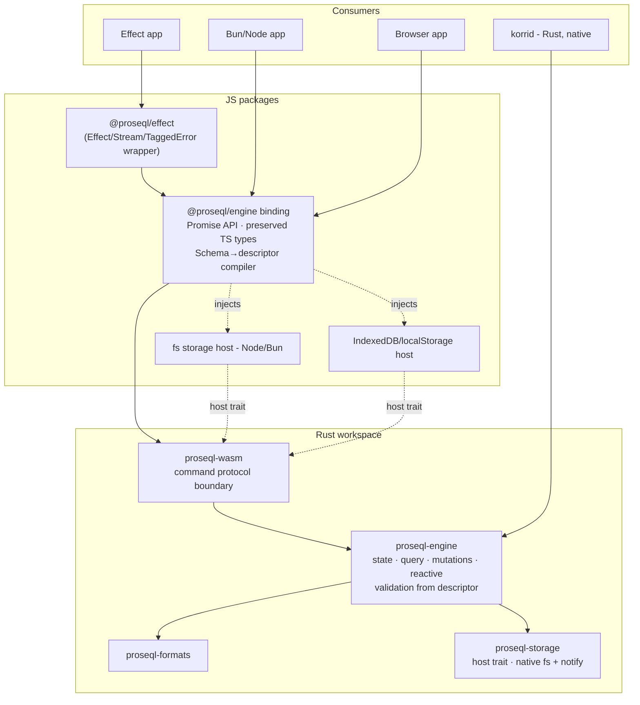
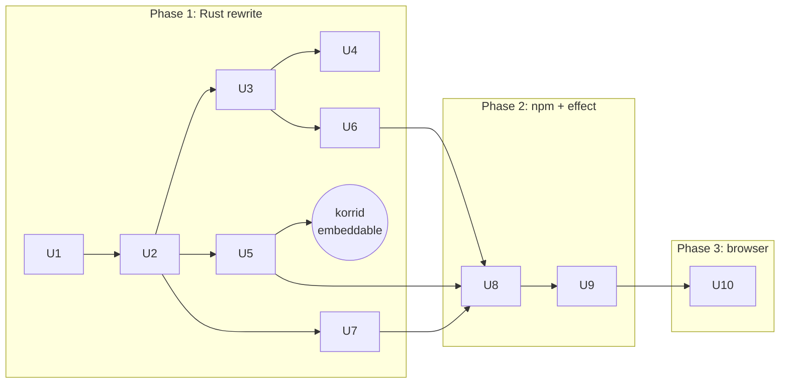

# refactor: Rust engine conversion with preserved TypeScript types

## Summary

Rewrite proseQL's runtime as a single Rust engine compiled natively (for korrid embedding) and to WASM (for all JS runtimes), while the existing TypeScript type layer is preserved verbatim as the compile-time contract of a Promise-first npm binding, with `@proseql/effect` restoring today's Effect ergonomics. Delivery is three phases: (1) Rust rewrite, (2) npm binding + `@proseql/effect`, (3) WASM in the browser. The ~85k-line TS test corpus is the conformance referee throughout.

---

## Problem Frame

proseQL is a project requirement for korri, whose services are Rust (`services/korrid` embeds on Android via cargo-ndk; JS runtimes are not available there). The current implementation is ~26k lines of Effect-based TypeScript pinned to `effect@4.0.0-beta.60`, runnable only on JS runtimes. A Rust engine makes proseQL embeddable in korrid, portable to the browser via WASM, and decouples the engine from Effect's beta release cadence — but the deeply-generic TS type surface (query inference, filter operators, population, computed fields) is a core product asset that must not be lost.

---

## Requirements

- R1. The Rust engine implements the full core semantics: CRUD + update operators, query pipeline (filters, sort, pagination, cursor, selection, search), aggregation, relationships/population, indexes, unique constraints, transactions, migrations, reactive watch, hooks, plugins, serialization formats, document/documentGraph sources
- R2. The public TypeScript type surface is preserved — the existing `packages/core/src/types/` layer remains the compile-time contract; no loss of type inference for consumers
- R3. The engine runs natively for korri embedding (Linux + Android arm64), usable as a Rust crate without any JS runtime
- R4. The engine runs in the browser via WASM with browser storage adapters
- R5. Effect consumers keep today's ergonomics (Effect return values, Stream watch, TaggedError `catchTag`) via `@proseql/effect`
- R6. Function-valued config — lifecycle hooks, computed fields, custom plugin operators — survives via host callbacks (JS callbacks over the boundary; Rust closures natively)
- R7. Parity is proven, not assumed: the existing TS test corpus re-runs against the Rust-backed binding, and no npm package flips to the Rust engine before its corpus passes
- R8. Delivery follows the agreed shape: phase 1 Rust rewrite, phase 2 npm binding + `@proseql/effect`, phase 3 browser/WASM

---

## Scope Boundaries

- No new database features during the port — feature freeze per module while it converts
- No comment/format-preserving YAML writes (today's engine doesn't promise this either)
- No non-JS language bindings beyond korri's native Rust use
- No consumer-facing Effect removal — the adapter keeps that world intact
- No published-package flip to Rust before the parity gate (R7); the TS engine keeps shipping meanwhile

### Deferred to Follow-Up Work

- CLI as a Rust binary (`proseql` static executable): follow-up after phase 2; the TS CLI keeps working against the binding meanwhile
- `@proseql/rest`, `@proseql/rpc`, `@proseql/ai` re-target onto the new binding: follow-up after phase 2 (they are consumers of core's API, which the binding preserves)
- napi-rs native addon behind the same binding API: contingency only, if phase-2 benchmarks show WASM overhead hurting a real workload
- npm release/versioning strategy for the flip (major-version plan, deprecation notes): decided when the parity gate is in sight
- korri-side integration (korrid consuming the crate): planned in the korri repo when the native milestone lands

---

## Context & Research

### Relevant Code and Patterns

- `packages/core/src/types/` (~3.5k lines) — the type asset to preserve: `types.ts` (FilterOperators, WhereClause shape-mirroring), `crud-types.ts`, `database-config-types.ts`, `crud-relationship-types.ts`, `aggregate-types.ts`, `computed-types.ts`, `cursor-types.ts`, `hook-types.ts`, `search-types.ts`, `reactive-types.ts` — all compile-time-only, no runtime dependency
- `packages/core/src/operations/` — query pipeline and CRUD semantics to port (`operations/query/`, `operations/crud/`, `operations/relationships/`)
- `packages/core/src/state/`, `indexes/`, `transactions/`, `migrations/`, `hooks/`, `plugins/`, `validators/` — engine subsystems
- `packages/core/src/serializers/` — codecs for JSON/YAML/TOML/JSON5/JSONC/Hjson/TOON + prose format; `packages/core/src/storage/` — storage service, document sources, documentGraph overlay, origin index, derived ids
- `packages/core/src/reactive/` — change pubsub, watch/watchById, debounced re-evaluation
- `packages/node/src/` (~500 lines) and `packages/browser/src/` (~1.4k lines) — the platform-adapter split the Rust storage-host design mirrors
- ~85k lines of core tests + `bench/` harness — conformance corpus and performance referee
- `examples/01`–`16` — executable documentation of the full public surface; must run unchanged against the binding after phase 2
- korri repo: `services/korrid` — cargo-ndk build path, JNI edge, and the consumer the native milestone serves

### Institutional Learnings

- CLAUDE.md: core must stay runtime-agnostic (no Node imports) — the Rust engine inherits this rule as "no platform I/O in the engine crate; storage is a host trait"
- CLAUDE.md: Effect APIs must be verified against the local `effect/` clone, not training data — relevant to the `@proseql/effect` adapter unit
- korri slice-4 lesson (cross-repo): validation must cover the whole surface, not one channel — parity gate must run the real TS suites, not a hand-picked subset

### External References

- wasm-bindgen + wasm-pack for the WASM boundary (async fns, JS callback imports)
- serde ecosystem crates: `serde_json`, `serde_yaml`/`saphyr`, `toml`, `json5`, `jsonc-parser` equivalents; Hjson/TOON/prose formats likely need in-house Rust ports
- `notify` crate for native file watching; `tokio` for async runtime (native), `wasm-bindgen-futures` (WASM)

---

## Key Technical Decisions

- **TS types are the contract; Rust implements the semantics**: the generic type layer cannot be code-generated from Rust (typeshare-class tools cannot express conditional/mapped types), so the direction reverses relative to codegen norms — preserved handwritten TS types type the boundary protocol at compile time, and the conformance corpus keeps the two sides honest
- **One engine crate, platform-blind**: all I/O behind a storage-host trait (read/write/list/watch). Native hosts in Rust (fs + notify); JS hosts injected over the WASM boundary (fs for Node/Bun, IndexedDB/localStorage for browser). Mirrors today's core/node/browser split
- **One boundary for all JS runtimes**: the npm binding runs the engine as WASM even in Node/Bun (JS fs storage host) rather than maintaining a napi addon per runtime. napi is a benchmarked contingency, not a plan item
- **Promise-first binding + `@proseql/effect` adapter**: the WASM boundary is Promise-shaped; Effect lives in one thin adapter that wraps Promises/AsyncIterables into Effects/Streams and reconstructs the same TaggedError classes, isolating the `effect@4.0.0-beta` pin from the engine
- **Boundary protocol is serialized commands**: config becomes a schema descriptor (compiled from Effect Schema AST on the JS side; defined directly in Rust natively); operations are a tagged command/response protocol; validation executes in the engine from the descriptor
- **Function-valued config becomes host callbacks**: hooks, computed fields, and custom operators are registered by id in the descriptor and invoked back into the host (JS function or Rust closure). Features are kept, not dropped
- **Value semantics are fixture-refereed**: JS-visible data semantics (Date, undefined-vs-null-vs-missing, numeric behavior, sort collation) must match the TS engine observably; the engine's internal value model is free, but every boundary-visible difference is a conformance bug
- **Conformance strategy is two-layered**: phase 1 ports representative TS test cases as Rust fixture tests (fast, native); phase 2 re-runs the actual TS suites through the binding (authoritative parity gate)

---

## Open Questions

### Resolved During Planning

- Keep or drop the Effect API? — Keep via adapter; core binding is Promise-first (user decision)
- Where does the work live? — Rust workspace inside this repo beside `packages/` (user decision)
- What drives priorities? — korrid embedding first; browser after npm binding (user decision)
- One JS mechanism or two? — WASM for all JS runtimes; napi only as benchmarked contingency

### Deferred to Implementation

- Exact schema-descriptor coverage of Effect Schema features (which Schema combinators consumers actually use beyond Struct/String/Number/Boolean/Array/optional — audit during U1 against examples and tests)
- Hjson/TOON/prose format porting depth: port fully vs. mark as host-side codecs initially — decide when U5 reaches them; corpus tells us what behavior is depended on
- Async host-callback re-entrancy on the WASM boundary (hooks that mutate during a mutation) — resolve against real TS hook tests in U8
- Watch debounce timing semantics across the boundary (10ms default; how timers behave in WASM) — resolve in U8 against reactive tests
- Whether the Rust engine exposes a sync API natively while remaining async at the WASM boundary — decide in U1 when the engine's execution model is set

---

## Output Structure

    crates/
    ├── proseql-engine/        # platform-blind core: state, query, mutations,
    │   │                      # relationships, indexes, transactions, migrations,
    │   │                      # reactive, validation, descriptor model
    │   ├── src/
    │   └── tests/             # ported conformance fixtures
    ├── proseql-formats/       # codecs: json, yaml, toml, json5, jsonc, jsonl,
    │   └── src/               # hjson, toon, prose
    ├── proseql-storage/       # storage-host trait + native fs/notify impl,
    │   └── src/               # document sources, documentGraph overlay, outbox
    ├── proseql-wasm/          # wasm-bindgen boundary: command protocol,
    │   └── src/               # JS host-callback imports
    └── Cargo.toml             # workspace
    packages/
    ├── engine/                # NEW npm binding: WASM artifact + preserved TS
    │   └── src/               # types typing the protocol; Promise-first API
    ├── effect/                # NEW @proseql/effect adapter
    │   └── src/
    └── (core, node, browser, cli, rest, rpc, ai unchanged until parity)

---

## High-Level Technical Design

> *This illustrates the intended approach and is directional guidance for review, not implementation specification. The implementing agent should treat it as context, not code to reproduce.*

Hooks/computed fields/custom operators flow the other direction: the engine invokes host callbacks registered in the descriptor (JS functions via the boundary; Rust closures for korrid).

Unit dependencies (phases per the agreed shape):

---

## Implementation Units

### U1. Rust workspace scaffold, config descriptor, conformance harness

**Goal:** The Rust workspace exists in-repo with the engine's foundational models: config descriptor (collections, schema shapes, id strategies, relationships, indexes, unique constraints, source configs), boundary value model, error taxonomy mirroring the TS TaggedErrors, and a fixture-based conformance test harness.

**Requirements:** R1, R2 (descriptor must express what the TS types express), R8

**Dependencies:** None

**Files:**
- Create: `crates/Cargo.toml`, `crates/proseql-engine/src/` (descriptor, value, errors modules)
- Create: `crates/proseql-engine/tests/` (harness + first fixtures)
- Modify: `flake.nix` (Rust toolchain devshell), `justfile` (rust check recipes)

**Approach:**
- Audit `examples/` and core tests for the Effect Schema subset actually used; the descriptor covers that subset and fails loudly on unsupported combinators
- Error taxonomy: one Rust enum variant per exported TS error class (`NotFoundError`, `DuplicateKeyError`, `ValidationError`, `UniqueConstraintError`, `ForeignKeyError`, `TransactionError`, `HookError`, `ConcurrencyError`, `OperationError`, storage/serialization/migration errors) with matching payload fields — the adapter reconstructs classes from these
- Conformance harness: fixtures as data files (config descriptor + operations + expected outcome) ported from TS test cases, runnable by plain `cargo test`

**Test scenarios:**
- Happy path: a descriptor round-trips serialization and validates a conforming record
- Error path: unsupported schema combinator in descriptor → loud, specific rejection
- Error path: schema violation produces the ValidationError-shaped payload with field paths matching TS behavior
- Edge case: optional vs. missing vs. null field handling matches TS engine observable behavior (fixture-refereed)

**Verification:**
- `cargo test` green; a first fixture ported from an existing core test passes; devshell builds on Linux

---

### U2. Engine state and CRUD semantics

**Goal:** In-memory collection state with full CRUD: create/read/update/delete/upsert, update operators (`$increment`, `$append`, `$toggle`, and the rest of the operator set), id strategies (provided, generated, `derivedFromKey`), unique constraints, and optimistic concurrency semantics where the TS engine has them.

**Requirements:** R1

**Dependencies:** U1

**Files:**
- Create: `crates/proseql-engine/src/state/`, `crates/proseql-engine/src/crud/`
- Test: `crates/proseql-engine/tests/` (CRUD fixtures)

**Approach:**
- Port semantics from `packages/core/src/state/`, `operations/crud/`, `validators/`; the TS files are the specification
- Unique-constraint and duplicate-key behavior must match error-for-error (fixtures from `operations/crud/unique-check` tests)

**Test scenarios:**
- Happy path: create with generated id, update by id, delete, upsert insert-vs-update branches — outcomes match ported fixtures
- Happy path: each update operator on its applicable types
- Error path: update non-existent id → NotFoundError; duplicate id → DuplicateKeyError; unique violation → UniqueConstraintError
- Edge case: `derivedFromKey` id injection matches TS behavior for document-source records
- Edge case: update operators on absent/null fields behave as the TS engine does (fixture-refereed)

**Verification:**
- CRUD fixture suite ported from representative TS test files passes

---

### U3. Query pipeline

**Goal:** The full query surface: where filters (all `FilterOperators` per type, nested shape-mirroring two levels deep, `$search` tokenization), sort (multi-field, JS-consistent collation), offset/limit and cursor pagination, field selection, full-text search indexes, aggregation (count/sum/avg/min/max/groupBy), and the computed-fields callback seam.

**Requirements:** R1, R6 (computed fields via host callback)

**Dependencies:** U2

**Files:**
- Create: `crates/proseql-engine/src/query/` (filter, sort, paginate, cursor, select, search, aggregate modules)
- Test: `crates/proseql-engine/tests/` (query fixtures)

**Approach:**
- Port from `operations/query/` and `types/operators.ts` runtime checks; operator-by-operator fixture parity
- Sort collation and stability must match JS observable ordering (biggest silent-divergence risk in the whole port — fixtures must cover mixed types, undefined placement, stability)
- Computed fields: engine requests values via host callback with the record as payload; natively a closure

**Test scenarios:**
- Happy path: every filter operator per type category (string/number/boolean/array/date) with ported expected outcomes
- Edge case: nested shape-mirroring filters at depth 2; filters on missing fields; `$in` with empty arrays
- Happy path: multi-field sort with mixed presence; cursor pagination round-trips (cursor from page N fetches page N+1, matches TS cursors' behavior contract)
- Happy path: each aggregate + groupBy against ported fixtures
- Integration: computed field callback is invoked per record and its output is filterable/sortable exactly as in TS
- Error path: dangling-cursor / malformed cursor behavior matches TS

**Verification:**
- Query fixture suite passes, including sort-collation fixtures designed to expose JS/Rust ordering divergence

---

### U4. Relationships and population

**Goal:** Relationship semantics: ref validation on write (ForeignKeyError), population (single, nested joins), dangling-reference behavior on read, and relationship-aware create/update/delete.

**Requirements:** R1

**Dependencies:** U3

**Files:**
- Create: `crates/proseql-engine/src/relationships/`
- Test: `crates/proseql-engine/tests/` (relationship fixtures)

**Approach:**
- Port from `operations/relationships/` and `operations/crud/*-with-relationships.ts`; preserve the exact populate-shape contract the TS types promise (populated fields replace foreign keys per the type layer)

**Test scenarios:**
- Happy path: populate single ref, nested populate two levels, populate with query filters on populated collections (if TS supports it — fixture the actual behavior)
- Error path: create with missing FK target → ForeignKeyError; delete a referenced record → whatever the TS engine does (fixture the actual semantics, restrict/cascade/ignore)
- Edge case: dangling reference at read time → matches TS `DanglingReferenceError` behavior

**Verification:**
- Relationship fixture suite passes; populate output shapes byte-match TS fixtures

---

### U5. Formats, storage hosts, and document sources

**Goal:** Persistence: the storage-host trait; format codecs (JSON, YAML, TOML, JSON5, JSONC, JSONL append-only, Hjson, TOON, prose); document sources (multi-file merge, strict duplicate/(collection,id) detection, unknown-collection policy, outbox for new records, origin-preserving writeback); documentGraph read-only overlay (ordered roots, later-wins, last-known-good reload); debounced persistence and flush; native fs host with notify-based watching.

**Requirements:** R1, R3

**Dependencies:** U2

**Files:**
- Create: `crates/proseql-formats/src/`, `crates/proseql-storage/src/`
- Test: `crates/proseql-formats/tests/`, `crates/proseql-storage/tests/` (fixtures incl. real files from `examples/` data)

**Approach:**
- Storage-host trait is deliberately narrow (read/write/list/remove/watch events) so JS hosts can implement it in U8/U10
- Port source semantics from `packages/core/src/storage/` (document-source, document-graph-source, origin-index, derived-id, transforms); YAML writes preserve data and sibling sections, not comments — same promise as today
- Hjson/TOON/prose: implement against the corpus's actual behavioral surface; if a format proves disproportionate, mark it host-side and record it as a deviation for the parity gate to catch

**Test scenarios:**
- Happy path: each format round-trips the shared fixture corpus; JSONL append-only appends
- Happy path: multi-file document source merges; existing records write back to origin file; new records land in outbox on flush
- Error path: duplicate (collection,id) across files → loud failure; unknown top-level key honors strict vs. preserve policy
- Happy path: documentGraph overlay: later root wins, mixed formats by extension, bad reload keeps last-known-good
- Integration: native fs host + watcher: external file edit triggers whole-source reload visible to a subsequent query
- Edge case: debounce coalesces rapid mutations into one write; flush forces immediately

**Verification:**
- Storage/format fixture suites pass; a native example binary can run the README quick-start flow against real files — **korrid-embeddable milestone reached**

---

### U6. Reactive engine: change events, watch, watchById

**Goal:** Change-event pubsub, `watch()`/`watchById()` as re-evaluated result streams with debounce and dedup, exposed as an engine subscription interface consumable natively (Rust streams/channels) and over the boundary (host push callbacks).

**Requirements:** R1, R6

**Dependencies:** U3

**Files:**
- Create: `crates/proseql-engine/src/reactive/`
- Test: `crates/proseql-engine/tests/` (reactive fixtures)

**Approach:**
- Port from `packages/core/src/reactive/`; keep the semantics (per-collection filtering, debounce interval, consecutive-dedup) and leave transport (AsyncIterable vs Stream) to the binding/adapter layers

**Test scenarios:**
- Happy path: mutation on watched collection emits exactly one re-evaluated result set after debounce; burst of mutations coalesces
- Edge case: identical consecutive results are deduplicated; unrelated-collection mutations don't emit
- Happy path: watchById emits on that record's change, completes/behaves per TS semantics on delete (fixture the actual behavior)
- Integration: source reload (from U5 watcher) flows through to watch subscribers

**Verification:**
- Reactive fixture suite passes with deterministic (virtual-time or tolerance-based) debounce assertions

---

### U7. Transactions, migrations, hooks, plugins

**Goal:** The remaining subsystems: transaction semantics (atomicity + rollback + TransactionError), migrations with dry-run, lifecycle hooks (before/after with validation/rejection) via host callbacks, and the plugin seam for custom operators.

**Requirements:** R1, R6

**Dependencies:** U2 (hooks/transactions), U3 (custom operators)

**Files:**
- Create: `crates/proseql-engine/src/transactions/`, `crates/proseql-engine/src/migrations/`, `crates/proseql-engine/src/hooks/`, `crates/proseql-engine/src/plugins/`
- Test: `crates/proseql-engine/tests/`

**Approach:**
- Port from `transactions/`, `migrations/`, `hooks/`, `plugins/`; hooks and custom operators are host callbacks registered by id in the descriptor — the engine awaits their results and honors rejection semantics (HookError)
- Migration dry-run returns the TS-shaped `DryRunResult` payload

**Test scenarios:**
- Happy path: multi-collection transaction commits atomically; failure mid-transaction rolls back all
- Happy path: migration transforms records; dry-run reports without mutating
- Integration: before-hook rejection aborts the mutation with HookError; after-hook observes committed state
- Integration: a custom operator registered via the plugin seam participates in where-filter evaluation
- Error path: hook callback that itself fails → HookError with cause, state unchanged

**Verification:**
- Subsystem fixture suites pass; phase-1 exit: full engine usable from Rust with all semantics fixture-covered

---

### U8. WASM boundary and npm binding with preserved types

**Goal:** Phase 2 opens: `proseql-wasm` exposes the command protocol via wasm-bindgen; a new npm binding package ships the WASM artifact with a Promise-first API whose compile-time surface is the preserved TS type layer; Node/Bun get a JS fs storage host; Effect Schema configs compile to descriptors at the boundary.

**Requirements:** R2, R6, R8

**Dependencies:** U5, U6, U7

**Files:**
- Create: `crates/proseql-wasm/src/`
- Create: `packages/engine/src/` (binding: API, Schema→descriptor compiler, callback registry, fs host)
- Test: `packages/engine/tests/` (binding tests; type-level assertion tests reusing existing type expectations)

**Approach:**
- The binding imports/adapts type definitions from `packages/core/src/types/` (move or re-export — decide at implementation; the types must remain single-sourced)
- Schema→descriptor compiler walks the Effect Schema AST for the audited subset (U1); unsupported combinators fail at db-creation time with a clear message
- Hooks/computed/custom operators: JS functions registered in a callback table, invoked from the engine via wasm-bindgen imports; watch delivered as host push → AsyncIterable
- Type preservation is testable: `tsd`-style or `expectTypeOf` assertions ported from existing type tests must compile identically against the binding

**Test scenarios:**
- Happy path: README quick-start runs on Bun against the WASM engine with real files via the fs host
- Integration: create→query→update→flush round-trip writes the same file bytes the TS engine writes for the same fixture (format parity)
- Integration: JS hook rejection, JS computed field, JS custom operator all function over the boundary
- Happy path: watch as AsyncIterable emits on mutation; unsubscribe cleans up
- Type-level: preserved query/filter/population inference compiles and rejects exactly as before (ported type assertions)
- Error path: engine errors surface as typed error objects carrying the TaggedError-equivalent tag + payload

**Verification:**
- Binding test suite green on Bun and Node; type assertions compile; a first slice of the core TS corpus (CRUD + query files) executes against the binding

---

### U9. @proseql/effect adapter and the parity gate

**Goal:** `@proseql/effect` restores today's ergonomics — Effect-returning methods, `Stream` watch, reconstructed TaggedError classes for `catchTag` — and the existing TS test corpus becomes the executable parity gate against the Rust engine.

**Requirements:** R5, R7

**Dependencies:** U8

**Files:**
- Create: `packages/effect/src/`
- Test: `packages/effect/tests/` plus a corpus-runner harness that executes existing `packages/core` test files against the adapter
- Modify: `justfile` (parity-gate recipe), CI workflow

**Approach:**
- Adapter wraps binding Promises via Effect constructors and AsyncIterables via Stream; error channel re-tags from boundary error objects into the same exported error classes (verify against the local `effect/` clone per CLAUDE.md, not memory)
- Parity gate: run core test suites with the database factory swapped to the Rust-backed adapter; produce a pass-rate report; triage failures into (engine bug | fixture ambiguity | Effect-internal test not applicable) with an explicit skip-list for the last category
- No package flip decisions here — the gate produces evidence; the flip is deferred follow-up work

**Test scenarios:**
- Happy path: `Effect.gen` + `yield*` flows from the README work unchanged against the adapter
- Happy path: `catchTag("DuplicateKeyError", ...)` catches the reconstructed class
- Happy path: `watch()` as Stream with debounce semantics preserved
- Integration: the parity-gate harness runs the corpus and emits a machine-readable pass-rate report; skip-list entries each carry a reason
- Error path: defects/unexpected boundary failures surface as Effect defects, not silent successes

**Verification:**
- Phase-2 exit: corpus pass-rate report exists in CI; remaining failures are triaged with reasons; examples 01–16 run against the adapter (or carry documented deviations)

---

### U10. Browser: storage hosts, packaging, and the browser package

**Goal:** Phase 3: the same WASM engine runs in the browser — IndexedDB and localStorage/sessionStorage hosts implementing the storage-host interface, bundler-friendly packaging of the WASM artifact, and `@proseql/browser` re-targeted onto the binding.

**Requirements:** R4, R8

**Dependencies:** U9

**Files:**
- Create: browser storage hosts in `packages/engine/src/` (or `packages/browser/src/` re-target — decide at implementation)
- Modify: `packages/browser/` to sit on the binding
- Test: browser-environment tests (happy-dom/playwright per repo conventions) covering hosts + boot

**Approach:**
- Port host semantics from `packages/browser/src/adapters/` (path-to-key mapping, format validation, watch implementation)
- Packaging: WASM artifact loading for Vite-class bundlers and plain `<script type="module">`; document loading paths
- Re-run the browser package's existing test suite against the new hosts as the browser parity gate

**Test scenarios:**
- Happy path: create→query→flush→reload persists through IndexedDB; same through localStorage within quota
- Edge case: quota exhaustion / storage denial surfaces as the TS StorageError equivalent
- Integration: watch works in-browser (mutation in one db instance emits to its subscribers)
- Integration: a minimal Vite example app boots the engine and runs the quick-start flow headlessly

**Verification:**
- Browser test suite green in CI; example app boots in a real browser; phase-3 exit reached

---

## System-Wide Impact

- **Interaction graph:** the binding replaces `createEffectDatabase`'s internals for everything downstream — cli/rest/rpc/ai eventually sit on it (deferred follow-up); korri's korrid consumes the engine crate directly
- **Error propagation:** Rust error enums → boundary error objects → reconstructed TaggedError classes; every layer must preserve tag + payload or `catchTag` consumers silently break — covered by U1 taxonomy + U9 tests
- **State lifecycle risks:** debounced writes and outbox semantics must not double-write or drop during flush-vs-debounce races (U5); WASM callback re-entrancy during hooks (deferred question, resolved in U8)
- **API surface parity:** the preserved TS types are shared between old core and new binding — they must stay single-sourced to prevent drift (U8 decision)
- **Integration coverage:** file-byte-level write parity (U8), watcher→watch flow (U5+U6), corpus re-run (U9)
- **Unchanged invariants:** published TS packages keep shipping unchanged until the parity gate passes; the plain-text file formats on disk are identical before and after — a proseQL data directory is engine-agnostic

---

## Risk Analysis & Mitigation

| Risk | Likelihood | Impact | Mitigation |
|------|-----------|--------|------------|
| Silent semantic divergence (sort collation, undefined/null/Date, numeric edge cases) | High | High | Fixture-refereed value semantics (U1, U3); corpus parity gate (U9) as backstop; divergences are bugs by definition |
| Effect Schema subset too rich for the descriptor | Medium | High | U1 audit against real usage before building; loud rejection of unsupported combinators; corpus reveals gaps early |
| Host-callback complexity on WASM (async hooks, re-entrancy) | Medium | Medium | Isolated in U8 with the TS hook tests as spec; natively callbacks are plain closures (korrid path unaffected) |
| Niche formats (Hjson/TOON/prose) disproportionate to port | Medium | Low | Behavioral-surface-first porting; host-side codec fallback recorded as explicit deviation |
| WASM performance insufficient for server workloads | Low | Medium | `bench/` harness comparison in phase 2; napi contingency behind the same binding API |
| Scope: ~26k lines to port; drift between TS engine and port during the long phase 1 | Medium | Medium | Per-module feature freeze; fixtures pinned to the TS version at port start; corpus re-run catches upstream drift at the gate |
| Type layer drifts from engine behavior (types promise what Rust doesn't do) | Low | High | Single-sourced types (U8); type assertions + runtime corpus both gate |

---

## Success Metrics

- Corpus pass-rate at the U9 parity gate trending to 100% minus an explicitly-triaged skip-list
- korrid can embed the engine crate and run catalog-class workloads from plain files with no JS runtime (phase-1 exit condition)
- `bench/` comparisons: WASM-backed binding within an acceptable factor of the TS engine on existing benchmarks (factor decided when first numbers exist)
- Examples 01–16 run against the binding unmodified (or with documented deviations)

---

## Documentation / Operational Notes

- README and package READMEs update at the flip (deferred follow-up), not during the port
- `CLAUDE.md` gains the Rust workspace layout and the "TS types are the contract" rule when U1 lands
- CI grows `cargo test` (phase 1) and the parity-gate job (phase 2); WASM artifact build caching will matter

---

## Alternative Approaches Considered

- **Incremental strangler port (module-by-module Rust inside the running TS engine)**: rejected — per-module FFI churn across a deeply interconnected pipeline costs more than a clean engine port with a corpus gate
- **napi-rs native addon as the primary JS mechanism**: rejected as primary — two boundaries (napi + WASM) to maintain; WASM serves all JS runtimes with one artifact; napi retained as benchmarked contingency
- **Generate TS types from Rust (typeshare-style, as korri does)**: rejected — conditional/mapped generic types (WhereClause, population inference) are inexpressible in codegen; direction reversed instead
- **Drop Effect entirely**: rejected — existing Effect consumers (and the user's own projects) keep first-class ergonomics via a thin adapter at near-zero engine cost

---

## Sources & References

- Origin: user directive (this conversation) — proseQL is a korri project requirement; convert to Rust; preserve all TS types; run in browser; phases: rust → npm+effect → wasm
- Related code: `packages/core/src/` (specification-by-implementation), `packages/core/src/types/` (preserved contract), `packages/node/`, `packages/browser/`, `bench/`, `examples/`
- Cross-repo: korri `services/korrid` (first native consumer; cargo-ndk/JNI path)
- External: wasm-bindgen guide, serde format crates, notify crate
